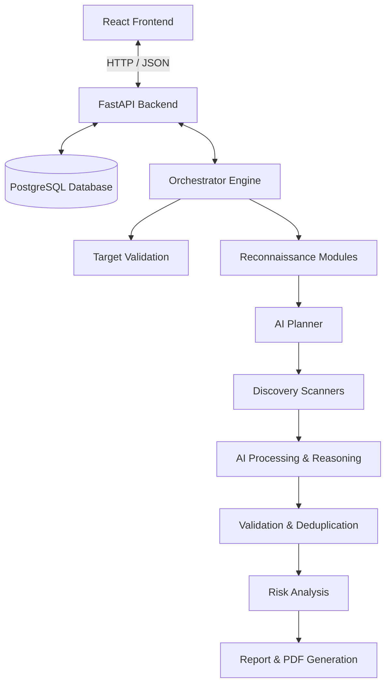

# Implementation Plan: AI-Powered Web Application Penetration Testing Platform

The AI-Powered Web Application Penetration Testing Platform is a modular, autonomous security assessment system. This plan outlines the technical design, data contracts, directory structure, and step-by-step roadmap to build and integrate the React frontend, FastAPI backend, central Orchestrator, reconnaissance and discovery modules, AI processing pipeline, validation engine, and reporting capabilities.

## User Review Required

> [!IMPORTANT]
> **API & Security Keys**
> The AI processing modules (Planner, Reasoning, Prioritizer, Summarizer) require integration with an LLM provider (e.g., Google Gemini, OpenAI, or Anthropic). We need to determine which LLM API will be used and secure the required API keys.
> 
> **Scanning Tools Setup**
> The Discovery modules wrapper (OWASP ZAP and Nuclei) rely on external binary executions. We must choose whether to assume these tools are pre-installed on the host system or run them inside containerized environments (Docker).
> 
> **Destructive Scans Safeguard**
> To avoid accidental damage to external systems, all automated scans will run with a safeguard flag and restrict targets to explicitly authorized hosts or localhost.

## Open Questions

> [!WARNING]
> 1. **Do we have access to a PostgreSQL instance?** We need to configure the database URI and schema initialization.
> 2. **Which LLM client or library should be used?** Should we use the official SDKs (e.g., `google-genai` or `openai`) or langchain/ollama for local AI runners?
> 3. **What format of reports is preferred?** Are there standard corporate report layouts required, or is a modern styled template for PDF generation acceptable?

---

## Proposed Changes

We will construct a new project from scratch inside the workspace. The directory layout is split into `backend/` and `frontend/`.



### 1. Database Schema Design
We will define PostgreSQL schemas using SQLAlchemy models. The schema tracks Target, Scan Session, Findings, Modules Executed, and Reports.

```sql
CREATE TYPE scan_status AS ENUM ('PENDING', 'VALIDATING', 'RECON', 'PLANNING', 'DISCOVERY', 'AI_PROCESSING', 'VALIDATION', 'RISK_ANALYSIS', 'REPORTING', 'COMPLETED', 'FAILED');
CREATE TYPE severity_level AS ENUM ('CRITICAL', 'HIGH', 'MEDIUM', 'LOW', 'INFO');

CREATE TABLE targets (
    id UUID PRIMARY KEY DEFAULT gen_random_uuid(),
    url VARCHAR(2048) NOT NULL,
    created_at TIMESTAMP WITH TIME ZONE DEFAULT NOW()
);

CREATE TABLE scan_sessions (
    id UUID PRIMARY KEY DEFAULT gen_random_uuid(),
    target_id UUID REFERENCES targets(id),
    status scan_status DEFAULT 'PENDING',
    current_stage VARCHAR(100),
    progress_percentage INTEGER DEFAULT 0,
    created_at TIMESTAMP WITH TIME ZONE DEFAULT NOW(),
    updated_at TIMESTAMP WITH TIME ZONE DEFAULT NOW()
);

CREATE TABLE scan_findings (
    id UUID PRIMARY KEY DEFAULT gen_random_uuid(),
    scan_id UUID REFERENCES scan_sessions(id),
    title VARCHAR(256) NOT NULL,
    description TEXT,
    severity severity_level,
    confidence VARCHAR(50),
    cve_id VARCHAR(50),
    remediation TEXT,
    evidence JSONB,
    source_scanner VARCHAR(100),
    status VARCHAR(50) DEFAULT 'UNVERIFIED', -- UNVERIFIED, VERIFIED, DUPLICATE, FALSE_POSITIVE
    created_at TIMESTAMP WITH TIME ZONE DEFAULT NOW()
);
```

---

### 2. Backend Foundation (FastAPI)

We will establish a robust FastAPI project structure.

#### [NEW] [requirements.txt](file:///p:/Pentest2/backend/requirements.txt)
Python dependencies including FastAPI, Uvicorn, SQLAlchemy, psycopg2-binary, Pydantic, dnspython, beautifulsoup4, playwright, jinja2, and weasyprint (or reportlab) for PDF generation.

#### [NEW] [main.py](file:///p:/Pentest2/backend/app/main.py)
FastAPI application gateway with middleware configurations (CORS), routes registration, exception handlers, and startup/shutdown lifespan logic.

#### [NEW] [config.py](file:///p:/Pentest2/backend/app/core/config.py)
System environment configuration manager using `pydantic-settings` to load DB URIs, API keys, scanner paths, and execution flags.

#### [NEW] [models.py](file:///p:/Pentest2/backend/app/db/models.py)
SQLAlchemy declarative models mapping targeting configurations, sessions, findings, and logs.

#### [NEW] [schemas.py](file:///p:/Pentest2/backend/app/db/schemas.py)
Pydantic validation schemas for API request validation, response serialization, and data enforcement.

---

### 3. Orchestration & State Engine

The orchestrator manages execution state, invokes modules sequentially, aggregates JSON outputs, and updates database progress.

#### [NEW] [engine.py](file:///p:/Pentest2/backend/app/orchestrator/engine.py)
Main workflow controller. Coordinates Target Validation, Recon, AI Planning, Discovery Scanners, AI Processing, Validation, Risk analysis, and Reporting. Uses asyncio for background execution.

#### [NEW] [context.py](file:///p:/Pentest2/backend/app/orchestrator/context.py)
In-memory/DB-backed session context that holds the target URL, scope rules, and outputs of each module.

---

### 4. Modular Engine Components & JSON Contracts

Each module resides in a separate Python package and consumes/emits predefined JSON contracts.

#### [NEW] [target_validation.py](file:///p:/Pentest2/backend/app/modules/recon/target_validation.py)
Resolves DNS host, sends HTTP/HTTPS probe request, follows redirects, inspects SSL cert parameters, and returns host reachability status.

#### [NEW] [dns_enum.py](file:///p:/Pentest2/backend/app/modules/recon/dns_enum.py)
Performs A, AAAA, MX, TXT, and NS query lookups.

#### [NEW] [subdomain_enum.py](file:///p:/Pentest2/backend/app/modules/recon/subdomain_enum.py)
Orchestrates passive and active subdomain finding using `subfinder` and `assetfinder` or falls back to public API scrapers if tools are not installed.

#### [NEW] [crawler.py](file:///p:/Pentest2/backend/app/modules/recon/crawler.py)
Performs headless crawling using Playwright or BeautifulSoup to parse DOM elements, href links, form elements, parameters, and paths.

#### [NEW] [tech_detect.py](file:///p:/Pentest2/backend/app/modules/recon/tech_detect.py)
Analyzes response headers, cookie patterns, HTML structures, and meta tags to identify frameworks, content management systems (CMS), and web servers.

#### [NEW] [header_analysis.py](file:///p:/Pentest2/backend/app/modules/recon/header_analysis.py)
Examines HTTP headers for missing/misconfigured security policies (e.g., CSP, HSTS, X-Frame-Options, X-Content-Type-Options).

#### [NEW] [recon_contract.py](file:///p:/Pentest2/backend/app/modules/recon/contract.py)
Pydantic contracts validating the unified Recon output.
```python
class ReconContract(BaseModel):
    target_url: str
    ip_addresses: List[str]
    dns_records: Dict[str, List[str]]
    subdomains: List[str]
    discovered_urls: List[str]
    technologies: List[str]
    insecure_headers: List[Dict[str, str]]
```

#### [NEW] [planner.py](file:///p:/Pentest2/backend/app/modules/ai/planner.py)
AI Planner using LLM integration to analyze the tech stack and URL list, returning a prioritized schedule of scans.

#### [NEW] [zap_scanner.py](file:///p:/Pentest2/backend/app/modules/discovery/zap_scanner.py)
OWASP ZAP REST API or local wrapper to initiate dynamic active/passive scans against targeted endpoints.

#### [NEW] [nuclei_scanner.py](file:///p:/Pentest2/backend/app/modules/discovery/nuclei_scanner.py)
Executes Nuclei templates against identified paths and assets.

#### [NEW] [api_scanner.py](file:///p:/Pentest2/backend/app/modules/discovery/api_scanner.py)
Parses Swagger/OpenAPI files, scans REST endpoints, and evaluates authorization parameter security.

#### [NEW] [ssl_scanner.py](file:///p:/Pentest2/backend/app/modules/discovery/ssl_scanner.py)
Queries SSL configurations for vulnerable cipher suites and handshake issues.

#### [NEW] [discovery_contract.py](file:///p:/Pentest2/backend/app/modules/discovery/contract.py)
Unified scanner finding contract.
```python
class Finding(BaseModel):
    title: str
    description: str
    severity: str
    cve_id: Optional[str]
    url: str
    evidence: Dict[str, Any]
    scanner: str

class DiscoveryContract(BaseModel):
    findings: List[Finding]
```

#### [NEW] [processing.py](file:///p:/Pentest2/backend/app/modules/ai/processing.py)
AI Reasoning, Prioritizer, and Summarizer implementations to structure findings, group related vulnerabilities, and generate natural language recommendations.

#### [NEW] [deduplicator.py](file:///p:/Pentest2/backend/app/modules/validation/deduplicator.py)
Groups findings with similar signatures, URLs, or CVE inputs to filter redundant reports.

#### [NEW] [verifier.py](file:///p:/Pentest2/backend/app/modules/validation/verifier.py)
Performs basic check-backs (e.g., verifying header existence or reproducing simple endpoints) to determine confidence scores.

#### [NEW] [analyzer.py](file:///p:/Pentest2/backend/app/modules/risk/analyzer.py)
Maps severity levels, estimates business impact, and assigns overall risk rankings.

#### [NEW] [generator.py](file:///p:/Pentest2/backend/app/modules/reporting/generator.py)
Generates the comprehensive JSON format report consolidating all lifecycle stages.

#### [NEW] [pdf_generator.py](file:///p:/Pentest2/backend/app/modules/reporting/pdf_generator.py)
Renders HTML structures via Jinja2 templates into a beautiful and professional PDF layout using Weasyprint or Reportlab.

---

### 5. React Frontend dashboard

We will build a React frontend with Vite. It features a modern dark mode design with sleek glassmorphism panels, progress indicator bars, interactive findings tables, and real-time step visualization.

#### Frontend Design Refinements & Implementation Requirements
While following the UI design, we will incorporate the following requirements during development:
1. **Interactive Dashboard Graph**: Implement dashboard graphs with interactive hover tooltips (showing label, value, timestamp) that are smooth and visually consistent.
2. **Single Validation Stage**: Implement only one Validation stage in the progress pipeline to keep the workflow logically ordered and visually balanced (removing duplicate validation steps).
3. **Technical Reconnaissance Details Modal**: Add a structured modal/popup to the Technical Reconnaissance section to view detailed information. Include a close button and outside-click support.
4. **Dashboard Action Button**: Implement the new scan action button with only a single "+" icon to maintain a clean and intuitive interface.

*General Instructions*: These are implementation improvements. Do not redesign the overall UI or change the visual identity. Preserve the existing layout, colors, typography, spacing, animations, and responsiveness.

#### [NEW] [package.json](file:///p:/Pentest2/frontend/package.json)
React setup with dependencies: Vite, React, Axios, Lucide-react (icons), and Chart.js or Recharts (for risk distribution charts).

#### [NEW] [index.css](file:///p:/Pentest2/frontend/src/index.css)
Core styling. Implements custom theme variables (dark/light, primary slate, secondary violet, emerald green, crimson red), layout rules, dynamic transitions, and modern glassmorphism panels.

#### [NEW] [App.jsx](file:///p:/Pentest2/frontend/src/App.jsx)
Application shell featuring layout routing, global status panels, and a responsive navigation header.

#### [NEW] [Dashboard.jsx](file:///p:/Pentest2/frontend/src/pages/Dashboard.jsx)
Shows historical scans list, summary metrics, and active scan widgets.

#### [NEW] [ScanForm.jsx](file:///p:/Pentest2/frontend/src/components/ScanForm.jsx)
Target URL entry form with input validation and scan customization flags.

#### [NEW] [ScanProgress.jsx](file:///p:/Pentest2/frontend/src/components/ScanProgress.jsx)
Visual stepper showing orchestrator phases (Target validation -> Recon -> AI Plan -> Discovery -> AI Processing -> Validation -> Completed) with a real-time status and animated progress bar.

#### [NEW] [FindingsList.jsx](file:///p:/Pentest2/frontend/src/components/FindingsList.jsx)
An interactive data table of discovered issues, allowing users to filter by severity, search by title, and drill down to view description, evidence, and AI remediation steps.

#### [NEW] [ReportViewer.jsx](file:///p:/Pentest2/frontend/src/components/ReportViewer.jsx)
Renders reports online and offers triggers to download PDFs and view raw JSON outputs.

---

## Verification Plan

### Automated Tests
- We will construct unit tests using pytest for backend modules:
  ```bash
  pytest backend/tests/
  ```
- Run code quality linter checks using Ruff or Flake8:
  ```bash
  ruff check backend/
  ```

### Manual Verification
1. **Target Validation test**: Submit an invalid URL to ensure the platform flags it and stops execution.
    progress_percentage INTEGER DEFAULT 0,
    created_at TIMESTAMP WITH TIME ZONE DEFAULT NOW(),
    updated_at TIMESTAMP WITH TIME ZONE DEFAULT NOW()
);

CREATE TABLE scan_findings (
    id UUID PRIMARY KEY DEFAULT gen_random_uuid(),
    scan_id UUID REFERENCES scan_sessions(id),
    title VARCHAR(256) NOT NULL,
    description TEXT,
    severity severity_level,
    confidence VARCHAR(50),
    cve_id VARCHAR(50),
    remediation TEXT,
    evidence JSONB,
    source_scanner VARCHAR(100),
    status VARCHAR(50) DEFAULT 'UNVERIFIED', -- UNVERIFIED, VERIFIED, DUPLICATE, FALSE_POSITIVE
    created_at TIMESTAMP WITH TIME ZONE DEFAULT NOW()
);
```

---

### 2. Backend Foundation (FastAPI)

We will establish a robust FastAPI project structure.

#### [NEW] [requirements.txt](file:///p:/Pentest2/backend/requirements.txt)
Python dependencies including FastAPI, Uvicorn, SQLAlchemy, psycopg2-binary, Pydantic, dnspython, beautifulsoup4, playwright, jinja2, and weasyprint (or reportlab) for PDF generation.

#### [NEW] [main.py](file:///p:/Pentest2/backend/app/main.py)
FastAPI application gateway with middleware configurations (CORS), routes registration, exception handlers, and startup/shutdown lifespan logic.

#### [NEW] [config.py](file:///p:/Pentest2/backend/app/core/config.py)
System environment configuration manager using `pydantic-settings` to load DB URIs, API keys, scanner paths, and execution flags.

#### [NEW] [models.py](file:///p:/Pentest2/backend/app/db/models.py)
SQLAlchemy declarative models mapping targeting configurations, sessions, findings, and logs.

#### [NEW] [schemas.py](file:///p:/Pentest2/backend/app/db/schemas.py)
Pydantic validation schemas for API request validation, response serialization, and data enforcement.

---

### 3. Orchestration & State Engine

The orchestrator manages execution state, invokes modules sequentially, aggregates JSON outputs, and updates database progress.

#### [NEW] [engine.py](file:///p:/Pentest2/backend/app/orchestrator/engine.py)
Main workflow controller. Coordinates Target Validation, Recon, AI Planning, Discovery Scanners, AI Processing, Validation, Risk analysis, and Reporting. Uses asyncio for background execution.

#### [NEW] [context.py](file:///p:/Pentest2/backend/app/orchestrator/context.py)
In-memory/DB-backed session context that holds the target URL, scope rules, and outputs of each module.

---

### 4. Modular Engine Components & JSON Contracts

Each module resides in a separate Python package and consumes/emits predefined JSON contracts.

#### [NEW] [target_validation.py](file:///p:/Pentest2/backend/app/modules/recon/target_validation.py)
Resolves DNS host, sends HTTP/HTTPS probe request, follows redirects, inspects SSL cert parameters, and returns host reachability status.

#### [NEW] [dns_enum.py](file:///p:/Pentest2/backend/app/modules/recon/dns_enum.py)
Performs A, AAAA, MX, TXT, and NS query lookups.

#### [NEW] [subdomain_enum.py](file:///p:/Pentest2/backend/app/modules/recon/subdomain_enum.py)
Orchestrates passive and active subdomain finding using `subfinder` and `assetfinder` or falls back to public API scrapers if tools are not installed.

#### [NEW] [crawler.py](file:///p:/Pentest2/backend/app/modules/recon/crawler.py)
Performs headless crawling using Playwright or BeautifulSoup to parse DOM elements, href links, form elements, parameters, and paths.

#### [NEW] [tech_detect.py](file:///p:/Pentest2/backend/app/modules/recon/tech_detect.py)
Analyzes response headers, cookie patterns, HTML structures, and meta tags to identify frameworks, content management systems (CMS), and web servers.

#### [NEW] [header_analysis.py](file:///p:/Pentest2/backend/app/modules/recon/header_analysis.py)
Examines HTTP headers for missing/misconfigured security policies (e.g., CSP, HSTS, X-Frame-Options, X-Content-Type-Options).

#### [NEW] [recon_contract.py](file:///p:/Pentest2/backend/app/modules/recon/contract.py)
Pydantic contracts validating the unified Recon output.
```python
class ReconContract(BaseModel):
    target_url: str
    ip_addresses: List[str]
    dns_records: Dict[str, List[str]]
    subdomains: List[str]
    discovered_urls: List[str]
    technologies: List[str]
    insecure_headers: List[Dict[str, str]]
```

#### [NEW] [planner.py](file:///p:/Pentest2/backend/app/modules/ai/planner.py)
AI Planner using LLM integration to analyze the tech stack and URL list, returning a prioritized schedule of scans.

#### [NEW] [zap_scanner.py](file:///p:/Pentest2/backend/app/modules/discovery/zap_scanner.py)
OWASP ZAP REST API or local wrapper to initiate dynamic active/passive scans against targeted endpoints.

#### [NEW] [nuclei_scanner.py](file:///p:/Pentest2/backend/app/modules/discovery/nuclei_scanner.py)
Executes Nuclei templates against identified paths and assets.

#### [NEW] [api_scanner.py](file:///p:/Pentest2/backend/app/modules/discovery/api_scanner.py)
Parses Swagger/OpenAPI files, scans REST endpoints, and evaluates authorization parameter security.

#### [NEW] [ssl_scanner.py](file:///p:/Pentest2/backend/app/modules/discovery/ssl_scanner.py)
Queries SSL configurations for vulnerable cipher suites and handshake issues.

#### [NEW] [discovery_contract.py](file:///p:/Pentest2/backend/app/modules/discovery/contract.py)
Unified scanner finding contract.
```python
class Finding(BaseModel):
    title: str
    description: str
    severity: str
    cve_id: Optional[str]
    url: str
    evidence: Dict[str, Any]
    scanner: str

class DiscoveryContract(BaseModel):
    findings: List[Finding]
```

#### [NEW] [processing.py](file:///p:/Pentest2/backend/app/modules/ai/processing.py)
AI Reasoning, Prioritizer, and Summarizer implementations to structure findings, group related vulnerabilities, and generate natural language recommendations.

#### [NEW] [deduplicator.py](file:///p:/Pentest2/backend/app/modules/validation/deduplicator.py)
Groups findings with similar signatures, URLs, or CVE inputs to filter redundant reports.

#### [NEW] [verifier.py](file:///p:/Pentest2/backend/app/modules/validation/verifier.py)
Performs basic check-backs (e.g., verifying header existence or reproducing simple endpoints) to determine confidence scores.

#### [NEW] [analyzer.py](file:///p:/Pentest2/backend/app/modules/risk/analyzer.py)
Maps severity levels, estimates business impact, and assigns overall risk rankings.

#### [NEW] [generator.py](file:///p:/Pentest2/backend/app/modules/reporting/generator.py)
Generates the comprehensive JSON format report consolidating all lifecycle stages.

#### [NEW] [pdf_generator.py](file:///p:/Pentest2/backend/app/modules/reporting/pdf_generator.py)
Renders HTML structures via Jinja2 templates into a beautiful and professional PDF layout using Weasyprint or Reportlab.

---

### 5. React Frontend dashboard

We will build a React frontend with Vite. It features a modern dark mode design with sleek glassmorphism panels, progress indicator bars, interactive findings tables, and real-time step visualization.

#### Frontend Design Refinements & Implementation Requirements
While following the UI design, we will incorporate the following requirements during development:
1. **Interactive Dashboard Graph**: Implement dashboard graphs with interactive hover tooltips (showing label, value, timestamp) that are smooth and visually consistent.
2. **Single Validation Stage**: Implement only one Validation stage in the progress pipeline to keep the workflow logically ordered and visually balanced (removing duplicate validation steps).
3. **Technical Reconnaissance Details Modal**: Add a structured modal/popup to the Technical Reconnaissance section to view detailed information. Include a close button and outside-click support.
4. **Dashboard Action Button**: Implement the new scan action button with only a single "+" icon to maintain a clean and intuitive interface.

*General Instructions*: These are implementation improvements. Do not redesign the overall UI or change the visual identity. Preserve the existing layout, colors, typography, spacing, animations, and responsiveness.

#### [NEW] [package.json](file:///p:/Pentest2/frontend/package.json)
React setup with dependencies: Vite, React, Axios, Lucide-react (icons), and Chart.js or Recharts (for risk distribution charts).

#### [NEW] [index.css](file:///p:/Pentest2/frontend/src/index.css)
Core styling. Implements custom theme variables (dark/light, primary slate, secondary violet, emerald green, crimson red), layout rules, dynamic transitions, and modern glassmorphism panels.

#### [NEW] [App.jsx](file:///p:/Pentest2/frontend/src/App.jsx)
Application shell featuring layout routing, global status panels, and a responsive navigation header.

#### [NEW] [Dashboard.jsx](file:///p:/Pentest2/frontend/src/pages/Dashboard.jsx)
Shows historical scans list, summary metrics, and active scan widgets.

#### [NEW] [ScanForm.jsx](file:///p:/Pentest2/frontend/src/components/ScanForm.jsx)
Target URL entry form with input validation and scan customization flags.

#### [NEW] [ScanProgress.jsx](file:///p:/Pentest2/frontend/src/components/ScanProgress.jsx)
Visual stepper showing orchestrator phases (Target validation -> Recon -> AI Plan -> Discovery -> AI Processing -> Validation -> Completed) with a real-time status and animated progress bar.

#### [NEW] [FindingsList.jsx](file:///p:/Pentest2/frontend/src/components/FindingsList.jsx)
An interactive data table of discovered issues, allowing users to filter by severity, search by title, and drill down to view description, evidence, and AI remediation steps.

#### [NEW] [ReportViewer.jsx](file:///p:/Pentest2/frontend/src/components/ReportViewer.jsx)
Renders reports online and offers triggers to download PDFs and view raw JSON outputs.

---

## Verification Plan

### Automated Tests
- We will construct unit tests using pytest for backend modules:
  ```bash
  pytest backend/tests/
  ```
- Run code quality linter checks using Ruff or Flake8:
  ```bash
  ruff check backend/
  ```

### Manual Verification
1. **Target Validation test**: Submit an invalid URL to ensure the platform flags it and stops execution.
2. **Reconnaissance test**: Run the target probe on a test endpoint (e.g. `http://example.com` or local testapp) and verify details are populated in the database.
3. **AI Reasoning test**: Provide mock scanner output to the processing module and verify that duplicates are correctly sorted, remediations generated, and severity prioritized.
4. **PDF Generation test**: Verify that downloading a report yields a formatted PDF document.
5. **Frontend workflow**: Walk through the user interface from submitting a scan, tracking the visual progress bar, viewing vulnerability findings, to downloading the report.

### Pruthyush - 2026-07-13

### Implemented Fixes and Features
- Downloads Fix: Replaced `window.open` handlers with robust `fetch` and blob generation for PDF/JSON downloading in the reports view.
- Real-Time Polling: Reduced the dashboard scan polling interval from 10s to 1s to make active scan statistics responsive.
- Component Cleanup: Removed a duplicate `Reports` component definition in `Reports.jsx` and re-integrated the pagination footer.
- Vulnerability Metrics: Added a "Low" vulnerability statistic box to the "Findings So Far" panel in `ReportDetails.jsx`.
- PDF Generation Fix: Resolved a critical crash in `pdf_generator.py` caused by a missing `json` library import, restoring PDF reporting.
- Scan Failure State: Configured the dashboard to properly display a "FAILED" badge and status when a background scan process crashes.
- Scan Termination: Added a "Terminate" action button on the Scans page, backed by a new `/api/scans/{scan_id}/terminate` API endpoint to gracefully kill running scans and mark them "TERMINATED".
- PDF Viewing: Modified the "View Report Online" (Eye) button to open the generated PDF directly in a new browser tab rather than navigating to the progress layout.
- Findings Sorting: Sorted the findings list by severity (Critical -> High -> Medium -> Low -> Info) for better prioritization.
- add a termination button on the scans pages for running scans
- if the user terminate a scan mark it as terminated
- if the url scan crashes then mark it as failed

---

## Frontend UI and Functionality Enhancements (Implemented)

This section summarizes the frontend improvements made to the Pentest2 web application, including navigation, validation, filtering, pagination, and report management features.

### Global Navigation & Routing
- Moved `BrowserRouter` to `main.jsx` to allow routing hooks (`useNavigate`, `useLocation`) within the top-level `App` component.
- Implemented conditional rendering in `App.jsx` to hide the search bar and "New Scan" button when navigating to the `/scan/new` route to reduce UI clutter.

### Global Search
- **App.jsx**: Added state and `onKeyDown` handlers to the top navigation search bar. Hitting `Enter` navigates the user to `/scans?q={searchQuery}`.
- **Scans.jsx**: Updated to read the `q` URL parameter and dynamically filter the `scans` table by matching the query against target names, IDs, statuses, and finding counts. Added a "No results found" empty state.

### New Scan Form & Validation
#### [MODIFY] [ScanForm.jsx](file:///p:/Pentest2/frontend/src/pages/ScanForm.jsx)
- **Legal Warning Modal**: Added a mandatory legal disclaimer pop-up that appears when initiating a new scan. The scan only proceeds if the user explicitly clicks "Accept".
- **Target Validation**: Implemented strict regex validation for the "Target URL / IP" field. It verifies if the input is a valid IPv4 address, a valid URL/Domain, or `localhost`. Displays an inline error message and prevents submission if the format is invalid.

### Custom Dropdowns & Filtering
#### [MODIFY] [Scans.jsx](file:///p:/Pentest2/frontend/src/pages/Scans.jsx)
- Replaced native HTML `<select>` elements for "FILTER STATUS" and "DATE" with custom React dropdown menus.
- Styled the custom dropdowns using existing `.profile-menu` CSS classes to ensure visual consistency with the top navigation theme.
- Wired up the "FILTER STATUS" logic to actively filter the scans table based on the selected state (e.g., Running, Completed, All Statuses).
- Implemented outside-click detection to automatically close open dropdowns.

### Pagination
#### [NEW] [Pagination.jsx](file:///p:/Pentest2/frontend/src/components/Pagination.jsx)
- Created a reusable, dynamic `Pagination` React component that handles page number calculation, ellipses rendering for large page counts, and state updates.
#### [MODIFY] [Scans.jsx](file:///p:/Pentest2/frontend/src/pages/Scans.jsx) & [Reports.jsx](file:///p:/Pentest2/frontend/src/pages/Reports.jsx)
- Replaced static pagination mocks with the new `Pagination` component.
- Configured tables to cleanly slice data arrays to display exactly 5 items per page.
- Footer text dynamically updates to reflect the current slice (e.g., "Showing 1 to 5 of 12 results").

### Report Actions & PDF Management
#### [MODIFY] [Reports.jsx](file:///p:/Pentest2/frontend/src/pages/Reports.jsx)
- **View Online**: Implemented a full-screen modal embedding the generated PDF report via an `<iframe>`.
- **Download**: Added functionality to forcefully download the PDF report locally using a hidden `<a>` tag.
- **Share**: Created a themed Share modal providing options to copy the direct PDF link (with visual feedback), send via email, share on Twitter/X, and share on WhatsApp.
- Fixed a JSX parsing error by wrapping the main dashboard UI and modals within a React Fragment (`<>...</>`).
#### [MODIFY] [index.css](file:///p:/Pentest2/frontend/src/index.css)
- Added dedicated CSS styles for the `.pdf-viewer-modal`, `.pdf-viewer-iframe`, and `.share-option-btn` components.

---

## Recent Implementation Updates

### Changes Made
- **Backend Enhancements**: Updated data models, schemas, and configurations (`schemas.py`, `models.py`, `config.py`, `main.py`). Implemented discovery contracts and added direct scan pipeline test scripts.
- **Frontend Enhancements**: Improved the UI/UX in `App.jsx`, `index.css`, `Scans.jsx`, and `Reports.jsx`. Introduced a new Login page (`Login.jsx`, `Login.css`).
- **Service Verification**: Confirmed that the backend API (port 8000) and frontend dashboard (port 5173) are running successfully.

### Branch Information
- All recent changes and code implementations have been pushed to the **`iju`** branch.


### Database Authentication Migration
- **PostgreSQL Integration**: Migrated the authentication system from localStorage to a secure PostgreSQL database.
- **Backend Security**: Added bcrypt via direct import in app/core/security.py for secure password hashing and verification.
- **API Endpoints**: Created app/api/auth.py with /api/auth/register and /api/auth/login endpoints.
- **Frontend Integration**: Updated Login.jsx to replace localStorage with Axios HTTP calls. Added an email field and robust backend error handling.

---

## Frontend UI and Functionality Enhancements (Implemented)

This section summarizes the frontend improvements made to the Pentest2 web application, including navigation, validation, filtering, pagination, and report management features.

### Global Navigation & Routing
- Moved `BrowserRouter` to `main.jsx` to allow routing hooks (`useNavigate`, `useLocation`) within the top-level `App` component.
- Implemented conditional rendering in `App.jsx` to hide the search bar and "New Scan" button when navigating to the `/scan/new` route to reduce UI clutter.

### Global Search
- **App.jsx**: Added state and `onKeyDown` handlers to the top navigation search bar. Hitting `Enter` navigates the user to `/scans?q={searchQuery}`.
- **Scans.jsx**: Updated to read the `q` URL parameter and dynamically filter the `scans` table by matching the query against target names, IDs, statuses, and finding counts. Added a "No results found" empty state.

### New Scan Form & Validation
#### [MODIFY] [ScanForm.jsx](file:///p:/Pentest2/frontend/src/pages/ScanForm.jsx)
- **Legal Warning Modal**: Added a mandatory legal disclaimer pop-up that appears when initiating a new scan. The scan only proceeds if the user explicitly clicks "Accept".
- **Target Validation**: Implemented strict regex validation for the "Target URL / IP" field. It verifies if the input is a valid IPv4 address, a valid URL/Domain, or `localhost`. Displays an inline error message and prevents submission if the format is invalid.

### Custom Dropdowns & Filtering
#### [MODIFY] [Scans.jsx](file:///p:/Pentest2/frontend/src/pages/Scans.jsx)
- Replaced native HTML `<select>` elements for "FILTER STATUS" and "DATE" with custom React dropdown menus.
- Styled the custom dropdowns using existing `.profile-menu` CSS classes to ensure visual consistency with the top navigation theme.
- Wired up the "FILTER STATUS" logic to actively filter the scans table based on the selected state (e.g., Running, Completed, All Statuses).
- Implemented outside-click detection to automatically close open dropdowns.

### Pagination
#### [NEW] [Pagination.jsx](file:///p:/Pentest2/frontend/src/components/Pagination.jsx)
- Created a reusable, dynamic `Pagination` React component that handles page number calculation, ellipses rendering for large page counts, and state updates.
#### [MODIFY] [Scans.jsx](file:///p:/Pentest2/frontend/src/pages/Scans.jsx) & [Reports.jsx](file:///p:/Pentest2/frontend/src/pages/Reports.jsx)
- Replaced static pagination mocks with the new `Pagination` component.
- Configured tables to cleanly slice data arrays to display exactly 5 items per page.
- Footer text dynamically updates to reflect the current slice (e.g., "Showing 1 to 5 of 12 results").

### Report Actions & PDF Management
#### [MODIFY] [Reports.jsx](file:///p:/Pentest2/frontend/src/pages/Reports.jsx)
- **View Online**: Implemented a full-screen modal embedding the generated PDF report via an `<iframe>`.
- **Download**: Added functionality to forcefully download the PDF report locally using a hidden `<a>` tag.
- **Share**: Created a themed Share modal providing options to copy the direct PDF link (with visual feedback), send via email, share on Twitter/X, and share on WhatsApp.
- Fixed a JSX parsing error by wrapping the main dashboard UI and modals within a React Fragment (`<>...</>`).
#### [MODIFY] [index.css](file:///p:/Pentest2/frontend/src/index.css)
- Added dedicated CSS styles for the `.pdf-viewer-modal`, `.pdf-viewer-iframe`, and `.share-option-btn` components.

---

## Recent Implementation Updates

### Changes Made
- **Backend Enhancements**: Updated data models, schemas, and configurations (`schemas.py`, `models.py`, `config.py`, `main.py`). Implemented discovery contracts and added direct scan pipeline test scripts.
- **Frontend Enhancements**: Improved the UI/UX in `App.jsx`, `index.css`, `Scans.jsx`, and `Reports.jsx`. Introduced a new Login page (`Login.jsx`, `Login.css`).
- **Service Verification**: Confirmed that the backend API (port 8000) and frontend dashboard (port 5173) are running successfully.

### Branch Information
- All recent changes and code implementations have been pushed to the **`iju`** branch.


### Database Authentication Migration
- **PostgreSQL Integration**: Migrated the authentication system from localStorage to a secure PostgreSQL database.
- **Backend Security**: Added bcrypt via direct import in app/core/security.py for secure password hashing and verification.
- **API Endpoints**: Created app/api/auth.py with /api/auth/register and /api/auth/login endpoints.
- **Frontend Integration**: Updated Login.jsx to replace localStorage with Axios HTTP calls. Added an email field and robust backend error handling.

---

## Admin Panel Feature Plan

This section outlines the Admin role system and the features available exclusively to admin users in the AI Pentest Platform.

### Admin Capabilities

#### 1. User Management
- View all registered users (username, email, role, registration date, last login)
- Promote a regular user to Admin role
- Demote an Admin back to regular user
- Suspend / deactivate a user account (block login without deleting data)
- Delete a user account and all associated scan data
- Reset a user's password (force-reset and send notification)

#### 2. Scan Management & Oversight
- View **all scans** across all users (not just their own)
- Filter and search scans by user, status, date, or target
- Forcefully terminate any running scan from any user
- Delete any scan record and its associated findings/reports
- Re-trigger a failed scan on behalf of a user

#### 3. System Configuration
- Update global settings such as `SAFE_MODE`, `LLM_PROVIDER`, and scanner paths from the UI (no need to edit `.env` manually)
- Configure rate limits for scans per user (e.g., max 5 concurrent scans per user)
- Toggle features on/off system-wide (e.g., disable PDF generation, disable Nuclei scanner)

#### 4. Analytics & Reporting Dashboard
- View a platform-wide analytics dashboard:
  - Total scans run (daily / weekly / monthly)
  - Total findings by severity across all users
  - Most scanned targets
  - Most active users
  - Scan failure rate
- Export platform analytics as CSV or PDF report

#### 5. Audit Log
- View a detailed audit log of all system actions:
  - User login / logout events
  - Scan start / stop / terminate events
  - Admin actions (user role changes, deletions, config changes)
  - API key usage events
- Filter audit logs by user, action type, or date range

#### 6. API Key Management
- View and rotate the platform's LLM API keys (Gemini/OpenAI)
- Invalidate compromised keys and replace them from the UI
- View API usage statistics (token count, cost estimate)

---

### Proposed Files for Admin Feature

#### Backend

##### [NEW] backend/app/db/models.py (MODIFY)
- Add `role` field to `User` model: `role: str = "user"` (values: `"user"`, `"admin"`)
- Add `is_active: bool = True` for account suspension support

##### [NEW] backend/app/api/admin.py
- Admin-only API routes protected by role-check dependency:
  - `GET /api/admin/users` — list all users
  - `PATCH /api/admin/users/{id}/role` — change user role
  - `PATCH /api/admin/users/{id}/suspend` — suspend/unsuspend user
  - `DELETE /api/admin/users/{id}` — delete user
  - `GET /api/admin/scans` — list all scans across users
  - `DELETE /api/admin/scans/{id}` — delete any scan
  - `POST /api/admin/scans/{id}/terminate` — force-terminate any scan
  - `GET /api/admin/analytics` — platform-wide stats
  - `GET /api/admin/audit-logs` — system audit trail
  - `GET /api/admin/config` — read system config
  - `PATCH /api/admin/config` — update system config

##### [NEW] backend/app/core/permissions.py
- Dependency function `require_admin(current_user)` to guard admin routes
- Returns `403 Forbidden` if the authenticated user is not an admin

##### [NEW] backend/app/db/audit_log.py
- SQLAlchemy model for `AuditLog` table: `id`, `user_id`, `action`, `target`, `timestamp`, `metadata`
- Helper function `log_action(user, action, target)` called throughout the codebase

---

#### Frontend

##### [NEW] frontend/src/pages/AdminPanel.jsx
- Main admin dashboard page with a sidebar sub-navigation:
  - Users tab
  - Scans tab
  - Analytics tab
  - Audit Logs tab
  - System Config tab

##### [NEW] frontend/src/pages/AdminUsers.jsx
- Table of all users with columns: Name, Email, Role, Status, Actions
- Action buttons: Promote, Demote, Suspend, Delete, Reset Password
- Search and filter by role / status

##### [NEW] frontend/src/pages/AdminScans.jsx
- Table of all scans across all users
- Shows: Target, User, Status, Findings count, Date
- Actions: View, Terminate, Delete

##### [NEW] frontend/src/pages/AdminAnalytics.jsx
- Charts showing: scan volume over time, findings by severity, top users, failure rates
- Uses Recharts (already a dependency)
- Export to CSV button

##### [NEW] frontend/src/pages/AdminAuditLog.jsx
- Filterable, paginated table of all audit log entries
- Columns: Timestamp, User, Action, Target, Details

##### [NEW] frontend/src/pages/AdminConfig.jsx
- Form-based UI to update system settings: LLM provider, safe mode toggle, rate limits, enabled scanners
- Saves to backend `/api/admin/config`

##### [MODIFY] frontend/src/App.jsx
- Add `/admin` route protected by admin role check
- Redirect non-admin users attempting to access `/admin` to the dashboard

##### [MODIFY] frontend/src/pages/Login.jsx
- After login, check user role from JWT/response and redirect admins to `/admin` instead of `/dashboard`

---

### Pruthyush - 2026-07-14

### Pending Admin Feature Implementation
- Add `role` and `is_active` fields to User model
- Create `backend/app/api/admin.py` with all admin routes
- Create `backend/app/core/permissions.py` with role guard
- Create `backend/app/db/audit_log.py` model and helper
- Build `AdminPanel.jsx`, `AdminUsers.jsx`, `AdminScans.jsx`, `AdminAnalytics.jsx`, `AdminAuditLog.jsx`, `AdminConfig.jsx` pages
- Protect `/admin` route in `App.jsx`
- Update `Login.jsx` to redirect admins correctly

---

## Current Tool Inventory

This section documents every tool and module currently active in the scanning pipeline.

### Recon Phase Tools (Stage 2)

| Tool / Module | File | What it Does | Type |
|---|---|---|---|
| **Target Validation** | `recon/target_validation.py` | DNS resolution, HTTP probe, IP check, safe-mode enforcement | Pure Python |
| **DNS Enumeration** | `recon/dns_enum.py` | A, AAAA, MX, TXT, NS record lookups | `dnspython` library |
| **Subdomain Enumeration** | `recon/subdomain_enum.py` | Brute-forces 14 common prefixes via `socket.gethostbyname()` | Pure Python |
| **Technology Detection** | `recon/tech_detect.py` | Reads HTTP response headers, cookies, HTML meta tags to identify stack | `requests` |
| **Header Analysis** | `recon/header_analysis.py` | Checks for missing/misconfigured CSP, HSTS, X-Frame-Options, etc. | Pure Python |

### AI Planning Phase (Stage 3)

| Tool / Module | File | What it Does | Type |
|---|---|---|---|
| **AI Planner** | `ai/planner.py` | Analyzes recon results, calls Gemini/OpenAI to decide which scanners to run | `google-genai` / `openai` |
| **Default Plan Fallback** | `ai/planner.py` | Static rule-based scanner selection if LLM is unavailable | Pure Python |

### Discovery Phase Scanners (Stage 4)

| Tool / Module | File | What it Does | Type |
|---|---|---|---|
| **SSL Scanner** | `discovery/ssl_scanner.py` | Checks TLS version, cert validity, cipher strength | Python `ssl` module |
| **API Scanner** | `discovery/api_scanner.py` | Fetches `/openapi.json`, `/swagger.json`, tests unauthenticated endpoints | `requests` |
| **Nuclei Scanner** | `discovery/nuclei_scanner.py` | Runs Nuclei binary for CVE/template matching | External binary (`nuclei`) |
| **ZAP Scanner** | `discovery/zap_scanner.py` | Full DAST spider + active scan via ZAP REST API | External service (ZAP daemon) |
| **Header Analysis Findings** | Built into `engine.py` | Converts header misconfigs into `FindingModel` records | Pure Python |

### AI Processing Phase (Stage 5)

| Tool / Module | File | What it Does | Type |
|---|---|---|---|
| **AI Finding Enricher** | `ai/processing.py` | Calls Gemini/OpenAI to rewrite raw scanner findings with explanations + remediation | `google-genai` / `openai` |
| **Static Remediation Fallback** | `ai/processing.py` | Rule-based remediations for SQL, XSS, SSL, header findings | Pure Python |

### Validation & Risk Phase (Stage 6)

| Tool / Module | File | What it Does | Type |
|---|---|---|---|
| **Deduplicator** | `validation/deduplicator.py` | Removes duplicate findings by title/scanner match | Pure Python |
| **Verifier** | `validation/verifier.py` | Assigns confidence scores to findings | Pure Python |
| **Risk Analyzer** | `risk/analyzer.py` | Maps severity, calculates business impact score | Pure Python |

### Reporting Phase (Stage 7)

| Tool / Module | File | What it Does | Type |
|---|---|---|---|
| **Report Generator** | `reporting/generator.py` | Compiles all findings into a structured JSON report | Pure Python |
| **PDF Generator** | `reporting/pdf_generator.py` | Renders Jinja2 HTML templates into PDF via WeasyPrint/Reportlab | `jinja2`, `reportlab` |

---

## AI Plan Testing — How to Verify the AI is Actually Planning

This section explains how to test whether the AI planner is correctly analyzing recon data and selecting the right scanners.

### What the AI Planner Does

```
RECON OUTPUT (technologies, hostname, dns_records)
           ↓
   AI Planner (Gemini/OpenAI)
           ↓
   Returns a JSON plan like:
   [
     { "scanner": "ssl_scanner", "description": "Target uses HTTPS, audit cipher suites." },
     { "scanner": "api_scanner", "description": "FastAPI detected, probe OpenAPI endpoints." }
   ]
           ↓
   Engine runs ONLY the scanners in this plan
```

### Test 1 — Inspect the Scan Logs in the UI
When a scan runs, look at the live log stream in the **Scan Progress** page. You will see lines tagged `[AI]`:
```
[AI] Core AI engine parsing reconnaissance results and scheduling active payloads.
[AI] Scheduled: ssl_scanner - Verify SSL certificate for api.example.com
[AI] Scheduled: api_scanner - Probe OpenAPI endpoints detected on FastAPI stack
```
If these lines appear, the AI plan was received and is being executed.

### Test 2 — Direct Unit Test for Planner
Run this directly from the backend:
```python
# backend/tests/test_planner.py
from app.modules.ai.planner import generate_scan_plan

def test_ai_plan_for_api_target():
    technologies = ["FastAPI", "Python", "Nginx"]
    hostname = "api.example.com"
    dns_records = {"A": ["93.184.216.34"], "MX": [], "TXT": []}

    plan = generate_scan_plan(technologies, hostname, dns_records)

    print("AI Scan Plan:", plan)
    assert isinstance(plan, list)
    assert len(plan) > 0
    assert all("scanner" in step for step in plan)
    # Verify AI recommended api_scanner for a FastAPI target
    scanners = [s["scanner"] for s in plan]
    assert "api_scanner" in scanners or "ssl_scanner" in scanners

if __name__ == "__main__":
    test_ai_plan_for_api_target()
    print("✅ AI Planner test passed")
```
Run it with:
```bash
cd backend
python -m pytest tests/test_planner.py -v
# or directly:
python tests/test_planner.py
```

### Test 3 — Compare AI Plan vs Default Plan
Set `GEMINI_API_KEY=""` in `.env` to force fallback, run a scan, then restore the key and run again. Compare the logs:
- **Without key**: Plan is rule-based (14 generic scanner entries)
- **With key**: Plan is AI-customized (fewer, more targeted scanners with specific justifications)

### Test 4 — Mock Target Test Script
The `implement` branch pulled in `backend/test_direct_pipeline.py`. Run it to test the entire AI pipeline end-to-end without the frontend:
```bash
cd backend
python test_direct_pipeline.py
```
This bypasses the frontend and directly invokes the orchestrator pipeline to verify each stage is working.

### Expected Outputs per Stage

| Stage | What to look for | Pass Condition |
|---|---|---|
| Target Validation | `"Target resolution successful"` in logs | IP resolved, HTTP 200 returned |
| Recon | DNS records + technologies populated | At least 1 technology detected |
| **AI Planning** | `[AI] Scheduled: ...` lines in logs | At least 1 scanner scheduled |
| **AI decides correctly** | `api_scanner` for API targets, `ssl_scanner` for HTTPS | Scanner name matches target tech |
| Discovery | Scanner outputs with finding counts | `>= 0 findings` (0 is ok, not an error) |
| **AI Processing** | Each finding gets AI-enriched description | `description` field longer than original raw text |
| Validation | Duplicate findings removed | Final count ≤ raw count |
| Reporting | PDF + JSON files created in `backend/reports/` | Files exist on disk |

---

## Tool Integration Roadmap

### Integration Priority — Sorted by Implementation Difficulty

| Priority | Tool | Difficulty | Effort | What it Adds | Type |
|---|---|---|---|---|---|
| 1 | **Security Headers Checker** | ⭐ Very Easy | Extend existing code | Grade A–F header scoring like securityheaders.io | Already in codebase |
| 2 | **crt.sh (Cert Transparency)** | ⭐ Very Easy | 10 lines of code | SSL-verified subdomains via free public API | HTTP call only |
| 3 | **Shodan API** | ⭐ Very Easy | 20 lines of code | Open ports & CVEs without touching target | HTTP call + API key |
| 4 | **subfinder** | ⭐⭐ Easy | Install Go binary | 50+ passive subdomain sources | Go binary |
| 5 | **Nikto** | ⭐⭐ Easy | Install via apt | Outdated software, dangerous files, misconfigs | Perl binary |
| 6 | **testssl.sh** | ⭐⭐ Easy | Clone + run | Heartbleed, BEAST, POODLE, cipher ranking | Bash script |
| 7 | **ffuf** | ⭐⭐⭐ Medium | Install Go binary + wordlist | Hidden endpoints, admin panels, backup files | Go binary |
| 8 | **amass** | ⭐⭐⭐ Medium | Install Go binary | Deep DNS + BGP + cert transparency OSINT | Go binary |
| 9 | **sqlmap** | ⭐⭐⭐⭐ Hard | Careful integration, safe mode | SQL injection detection | Python tool, high risk |
| 10 | **Metasploit RPC** | ⭐⭐⭐⭐⭐ Very Hard | Full MSF setup + controlled env | CVE exploit verification | Requires Metasploit |

---

### Phase 1 — Very Easy (Pure Python / HTTP calls, no install needed)

#### 1. Security Headers Checker (like securityheaders.io) ← see dedicated section below

#### 2. crt.sh — Certificate Transparency Subdomains
- **How**: HTTP GET to `https://crt.sh/?q=%.{hostname}&output=json`
- **What it adds**: Finds subdomains issued real SSL certs — far more accurate than brute-force
- **File**: Update `backend/app/modules/recon/subdomain_enum.py`
- **Test**: Query `crt.sh` for `google.com`, verify hundreds of results returned

#### 3. Shodan API — OSINT Without Touching Target
- **How**: HTTP GET to `https://api.shodan.io/shodan/host/{ip}?key=APIKEY`
- **What it adds**: Open ports, services, known CVEs indexed by Shodan crawlers
- **File**: New `backend/app/modules/recon/shodan_recon.py`
- **Test**: Query known IP, verify ports/vulns returned without sending a single packet to target

---

### Phase 2 — Easy (Install binary once, wrap with subprocess)

#### 4. subfinder — Passive Subdomain Enumeration
- **Install**: `go install github.com/projectdiscovery/subfinder/v2/cmd/subfinder@latest`
- **How**: `subprocess.run(["subfinder", "-d", hostname, "-json"])`
- **What it adds**: 50+ passive sources (VirusTotal, CertDB, PassiveDNS, etc.)
- **File**: Update `backend/app/modules/recon/subdomain_enum.py`
- **Test**: Run against `tesla.com`, verify >100 subdomains returned

#### 5. Nikto — Web Server Misconfig Scanner
- **Install**: `apt install nikto` or Docker image
- **How**: `subprocess.run(["nikto", "-h", target, "-Format", "json", "-output", "out.json"])`
- **What it adds**: Outdated software banners, dangerous default files, server misconfigs
- **File**: New `backend/app/modules/discovery/nikto_scanner.py`

#### 6. testssl.sh — Deep TLS Audit
- **Install**: `git clone https://github.com/drwetter/testssl.sh`
- **How**: `subprocess.run(["testssl.sh", "--jsonfile", "out.json", target])`
- **What it adds**: Heartbleed, BEAST, POODLE, SWEET32, cipher suite ranking
- **File**: Update `backend/app/modules/discovery/ssl_scanner.py`

---

### Phase 3 — Medium (Binary + configuration + wordlists needed)

#### 7. ffuf — Directory & Endpoint Fuzzer
- **Install**: `go install github.com/ffuf/ffuf/v2@latest`
- **How**: `subprocess.run(["ffuf", "-u", f"{target}/FUZZ", "-w", "wordlist.txt", "-of", "json"])`
- **What it adds**: Hidden admin panels, backup files, undocumented endpoints
- **File**: New `backend/app/modules/discovery/ffuf_scanner.py`
- **Extra needed**: Download SecLists wordlist (`common.txt` or `raft-medium-directories.txt`)

#### 8. amass — Deep OSINT Recon
- **Install**: `go install github.com/owasp-amass/amass/v4/...@master`
- **How**: `amass enum -passive -d hostname -json out.json`
- **What it adds**: Deep DNS + certificate transparency + BGP data + web archives
- **File**: Update `backend/app/modules/recon/subdomain_enum.py`

---

### Phase 4 — Advanced (Controlled environments only, legal risk)

#### 9. sqlmap — SQL Injection Detection
- **Install**: `pip install sqlmap` or use Docker
- **How**: `sqlmap -u "target/page?id=1" --batch --level=1 --output-dir=./results --forms`
- **⚠️ CAUTION**: Only run with explicit written authorization. Always use `--level=1` and `--risk=1`
- **File**: New `backend/app/modules/discovery/sqlmap_scanner.py`

#### 10. Metasploit RPC — CVE Exploit Verification
- **Install**: Full Metasploit Framework setup required
- **How**: Connect to `msfrpcd`, query module availability for a given CVE ID
- **⚠️ CAUTION**: Proof-of-concept only, never exploit in production — read-only verification
- **File**: New `backend/app/modules/validation/msf_verifier.py`

---

## Security Headers Checker Feature (like securityheaders.io)

### What securityheaders.io Does
It fetches a URL's HTTP response headers and gives a letter grade (A+ to F) based on which security headers are present, correctly configured, or missing — all from a single HTTP request, no tools needed.

### Current State in Project
The project already has a basic version in [`header_analysis.py`](file:///p:/Pentest2/backend/app/modules/recon/header_analysis.py) that checks 5 headers. But it only returns a list of issues — it does **not** give a grade, does not check all important headers, and has no dedicated API endpoint or frontend display.

### What Needs to Be Added

#### Headers Currently Checked (5)
| Header | Check |
|---|---|
| Content-Security-Policy | Missing / weak (unsafe-inline/eval) |
| Strict-Transport-Security | Missing |
| X-Frame-Options | Missing |
| X-Content-Type-Options | Missing / not "nosniff" |
| Referrer-Policy | Missing |

#### Headers to Add (7 more for full securityheaders.io parity)
| Header | Why it matters | Severity |
|---|---|---|
| `Permissions-Policy` | Controls access to browser APIs (camera, mic, geolocation) | MEDIUM |
| `Cross-Origin-Opener-Policy` (COOP) | Prevents cross-origin window attacks | MEDIUM |
| `Cross-Origin-Embedder-Policy` (COEP) | Required for SharedArrayBuffer isolation | LOW |
| `Cross-Origin-Resource-Policy` (CORP) | Blocks cross-origin resource leaks | LOW |
| `X-XSS-Protection` | Deprecated but still checked; flag if set to `0` | INFO |
| `Server` header | Leak of web server type (Nginx/Apache version) | LOW |
| `X-Powered-By` | Leak of backend framework (PHP/Express version) | LOW |

#### Grading System (like securityheaders.io)
| Grade | Condition |
|---|---|
| **A+** | All headers present, none weak or leaking |
| **A** | All critical headers present, minor optional ones missing |
| **B** | 1 HIGH header missing |
| **C** | 2 HIGH or 1 CRITICAL header missing |
| **D** | Multiple HIGH headers missing |
| **F** | CSP or HSTS missing + multiple others missing |

### Proposed Implementation

#### Backend Changes

##### [MODIFY] `backend/app/modules/recon/header_analysis.py`
- Expand from 5 to 12 header checks
- Add `calculate_header_grade(findings)` function that returns `A+` to `F`
- Return both `findings` list and `grade` string from the main function

##### [NEW] `backend/app/api/endpoints.py` (add route)
- `GET /api/headers?url={target_url}` — standalone header scan endpoint
- Fetches headers, runs analysis, returns grade + all findings
- Can be called independently (no need to run a full scan)

#### Frontend Changes

##### [NEW] `frontend/src/pages/HeaderChecker.jsx`
- Dedicated page at `/headers` route
- Input box: enter any URL
- On submit: calls `/api/headers?url=...`
- Displays:
  - **Big grade badge** (A+ in green, F in red)
  - **Header table** with each header: name, status (✅ Pass / ⚠️ Weak / ❌ Missing), severity badge, description
  - **Missing headers** highlighted in red
  - **What to fix** section with recommended Nginx/Apache config snippets

##### [MODIFY] `frontend/src/pages/ReportDetails.jsx`
- Add a **Security Headers** panel in the existing scan report view
- Shows the grade + header table for the scanned target (uses data already collected during recon stage)

##### [MODIFY] `frontend/src/App.jsx`
- Add `/headers` route pointing to `HeaderChecker.jsx`
- Add "Header Checker" link in the sidebar navigation

### Test Plan for Header Checker
```bash
# Test via API directly
curl "http://localhost:8000/api/headers?url=https://google.com"
# Expected: grade A or B, CSP present, HSTS present

curl "http://localhost:8000/api/headers?url=http://example.com"  
# Expected: grade D or F, HSTS missing (HTTP), CSP missing

# Unit test
python -c "
import requests
r = requests.get('https://google.com')
from app.modules.recon.header_analysis import analyze_security_headers
findings = analyze_security_headers(r)
print('Findings:', len(findings))
"
```

>>>>>>> c1533d0690b48fd1c8c0cc8b7e428587658c854b
